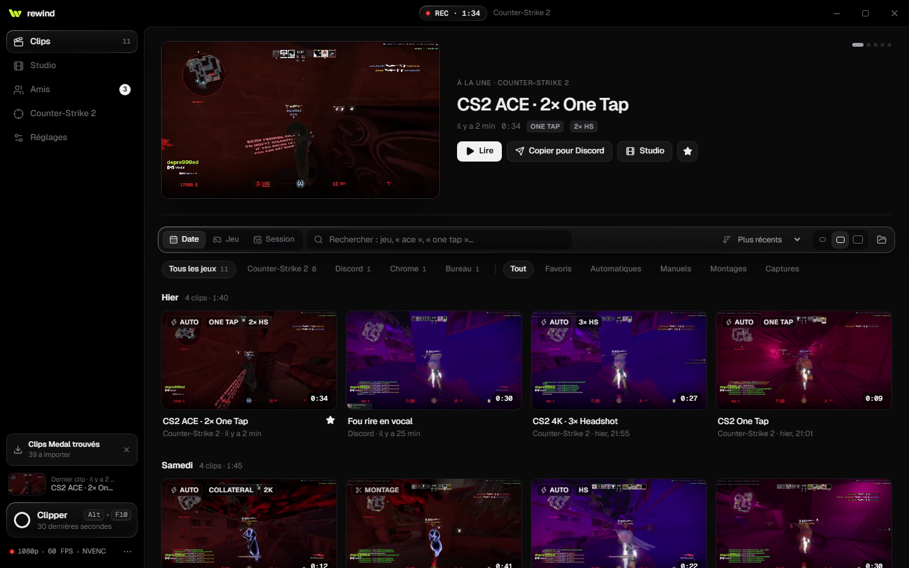
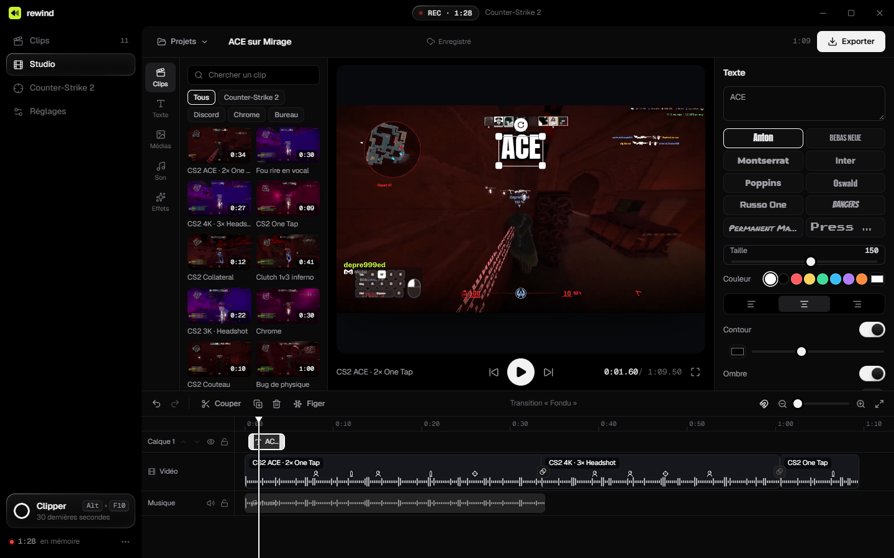
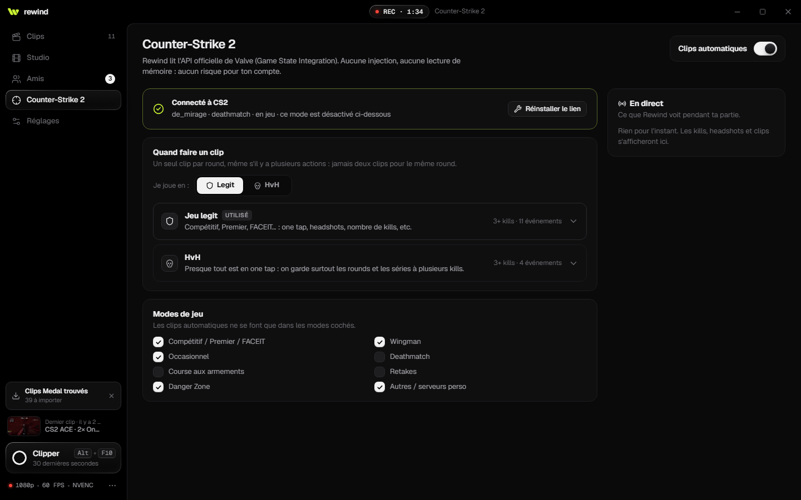

# Rewind

**The last seconds of your screen, always within reach.** 
Press a hotkey and the clip is saved. In Counter-Strike 2, your best rounds are clipped for you.

[Features](#features) · [Install](#install) · [Hotkeys](#hotkeys) · [Counter-Strike 2](#counter-strike-2) · [Privacy](#privacy) · [Français](README.md)

 

 

## Why Rewind

You are playing, something wild happens, and it is too late to start recording.
Rewind runs in the background and keeps the last few minutes in memory. Press a hotkey and what just happened
is saved, with your PC sound, your microphone and Discord.

- **Light.** About 25 MB of memory for the engine while the window is closed. Encoding runs on your graphics card.
- **Anti-cheat safe.** Rewind records with Windows Graphics Capture, like the Windows Snipping Tool. It injects nothing into games.
- **Private.** No account, no analytics. Your clips stay on your PC.
- **Stable.** If the recorder crashes, it restarts within 2 seconds, and a clip that spans the crash is stitched back together without a gap.

## Features

<table>
<tr>
<td width="50%" valign="top">

### Record
- Clip the last 30 seconds or the last 2 minutes, both adjustable
- Custom clip: press once to start, once to stop
- Full session in a single file, with highlights marked
- Separate audio tracks: PC, microphone, Discord, and any application you like
- 1080p at 60 frames per second by default, even frame pacing on 100 Hz and faster screens

</td>
<td width="50%" valign="top">

### Edit and share
- Editing Studio: projects, stacked tracks, animated text (16 fonts, including gothic ones), images, GIFs, picture-in-picture video, blurred area
- Animated zoom, speed ramps, colors, freeze frames, several audio tracks, voice-over, keyframes
- Effects: shake, flash, glitch, black and white, negative, fade to black, vignette, cinema bars; everything shows and plays live in the preview
- Ready-made formats: 16:9, 9:16 or 1:1 (blurred background or cropped), 10 or 20 MB files
- "Copy for Discord" compresses to the right size and puts the clip on the clipboard
- Keyboard and mouse presses shown on the video, if you want them
- Offline voice command "Rewind clip"

</td>
</tr>
</table>

## Counter-Strike 2

Rewind reads Valve's official API, the one used by broadcast overlays (Game State Integration).
It does not read game memory and injects nothing: no risk for your account.

- **One clip per round.** Even if the round has several great moments, you get a single clip.
- **You choose what triggers it**: kills in the round, one tap, headshot, knife, Zeus, collateral, ace.
- **Two profiles.** Legit for competitive, Premier or FACEIT. HvH for community servers, deathmatch and practice, each with its own settings.

The screenshots show the French interface. The language can be changed in Settings.

## Install

1. Download `Rewind_<version>_x64-setup.exe` from the [latest release](https://github.com/depre99ed/Rewind/releases/latest).
2. Run it. It installs for your Windows account only, without administrator rights.
3. Windows may show "Windows protected your PC", because the installer does not have a publisher certificate yet.
   Click **More info**, then **Run anyway**.

**Updates.** Rewind checks for a new version at startup, then every 4 hours. A button appears at the top of the window:
click "Install and restart" whenever you want. Every update is signed, and Rewind rejects any version that is not signed
with the project key.

**Compatibility.** Tested on Windows 11. Windows 10 (version 2004 or newer) should work, but I have not verified it.

**Recommended hardware.** An NVIDIA (NVENC), AMD (AMF) or Intel (Quick Sync) graphics card. Without a hardware encoder,
Rewind falls back to 720p at 30 frames per second on the CPU to stay light.

## Hotkeys

All hotkeys can be changed in Settings → Hotkeys: a single key (<kbd>F8</kbd>), a combination or a mouse button.
They work even while you hold Ctrl or Shift in game (crouching, walking).

| Hotkey | Action |
|---|---|
| <kbd>Alt</kbd> + <kbd>F10</kbd> | Keep the last 30 seconds |
| <kbd>Alt</kbd> + <kbd>Shift</kbd> + <kbd>F10</kbd> | Keep the last 2 minutes |
| <kbd>Alt</kbd> + <kbd>F11</kbd> | Custom clip: start, then stop |
| <kbd>Alt</kbd> + <kbd>F7</kbd> | Full session: start, then stop |
| <kbd>Alt</kbd> + <kbd>F8</kbd> | Add a marker to the running session |
| <kbd>Alt</kbd> + <kbd>F12</kbd> | Screenshot |
| <kbd>Alt</kbd> + <kbd>F9</kbd> | Pause or resume recording |

When a game starts, a small 6-second banner reminds you of these hotkeys.

## Privacy

Your clips are stored in `Videos\Rewind\<game>\`. Settings and the log are in `%LOCALAPPDATA%\com.rewind.app\`.
Rewind only goes online in two cases:

- to check for updates, on this repository's releases page;
- to send a clip to a Discord webhook, if you set one up.

## For developers

Engine in Rust (Tauri 2), interface in Svelte 5, recording through FFmpeg. Build steps, architecture and tests are in
[`rewind/README.md`](rewind/README.md) (in French). Publishing a version is described in [`PUBLICATION.md`](PUBLICATION.md) (in French).

## License

FFmpeg ships with Rewind under its own license ([text](rewind/src-tauri/bin/FFMPEG-LICENSE.txt)).
The license for Rewind's own code has not been chosen yet.
