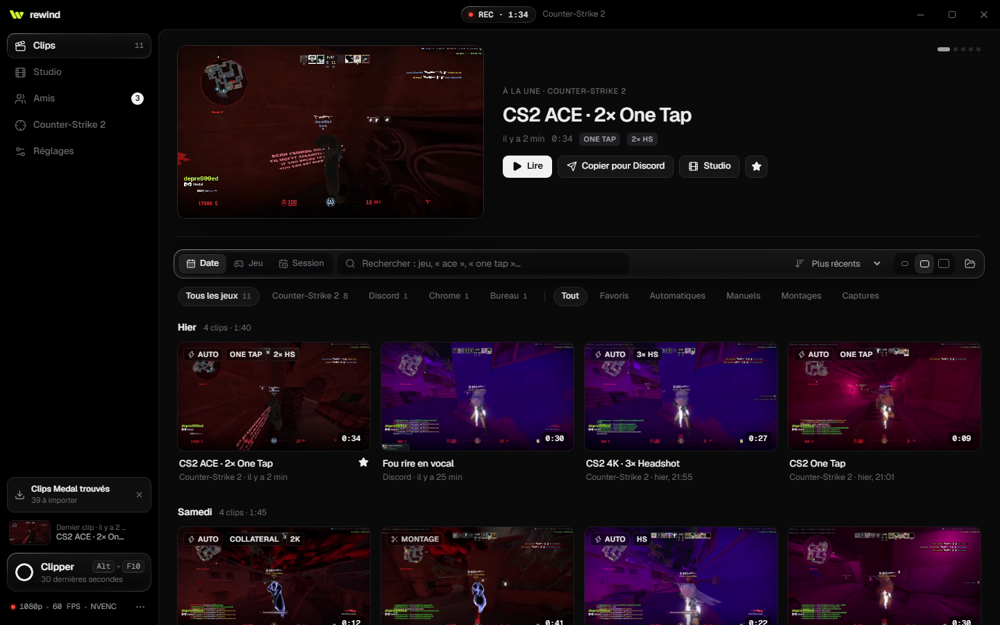
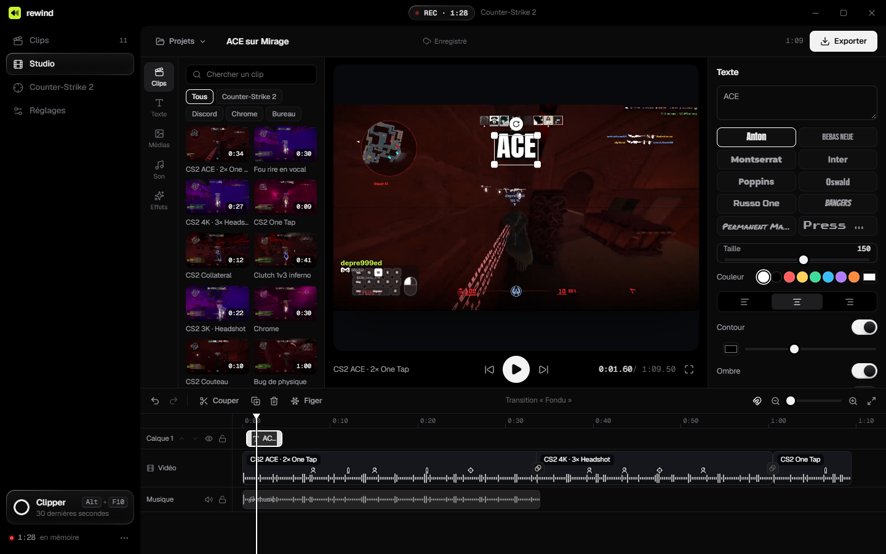
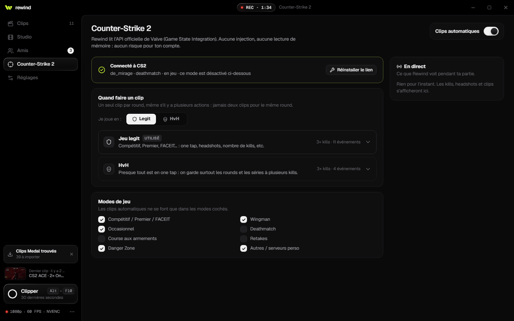

# Rewind

**Les dernières secondes de ton écran, toujours sous la main.** 
Un raccourci, et le clip est sauvé. Sur Counter-Strike 2, les meilleurs rounds se clippent tout seuls.

[Fonctionnalités](#fonctionnalités) · [Installer](#installer) · [Raccourcis](#raccourcis) · [Counter-Strike 2](#counter-strike-2) · [Confidentialité](#confidentialité) · [English](README.en.md)

 

 

## Pourquoi Rewind

Tu joues, quelque chose de fou se passe, et c'est déjà trop tard pour lancer un enregistrement.
Rewind tourne en arrière-plan et garde en mémoire les dernières minutes. Tu appuies sur un raccourci,
et ce qui vient de se passer est sauvé, avec le son de ton PC, ton micro et Discord.

- **Léger.** Environ 25 Mo de mémoire pour le moteur quand la fenêtre est fermée. L'encodage se fait sur ta carte graphique.
- **Sûr avec les anti-triche.** Rewind filme avec Windows Graphics Capture, comme l'outil Capture d'écran de Windows. Il n'injecte rien dans les jeux.
- **Privé.** Pas de compte, pas de statistiques. Tes clips restent sur ton PC.
- **Stable.** Si l'enregistreur plante, il repart en 2 secondes, et un clip à cheval sur la panne est recollé sans trou.

## Fonctionnalités

<table>
<tr>
<td width="50%" valign="top">

### Enregistrer
- Clip des 30 dernières secondes ou des 2 dernières minutes, durées réglables
- Clip sur mesure : un appui pour le début, un pour la fin
- Session complète en un seul fichier, avec les moments forts repérés
- Son sur pistes séparées : PC, micro, Discord, et chaque application si tu veux
- 1080p à 60 images par seconde par défaut, image régulière sur les écrans 100 Hz et plus

</td>
<td width="50%" valign="top">

### Monter et partager
- Studio : frise avec vignettes et forme d'onde, découpe, transitions, musique de fond
- Formats prêts : 16:9, 9:16 flou ou recadré, fichiers de 10 ou 20 Mo
- « Copier pour Discord » compresse à la bonne taille et met le clip dans le presse-papiers
- Touches du clavier et de la souris affichées sur la vidéo, si tu le souhaites
- Commande vocale « Rewind clip », hors ligne

</td>
</tr>
</table>

## Counter-Strike 2

Rewind lit l'API officielle de Valve, la même que celle des overlays de diffusion (Game State Integration).
Il ne lit pas la mémoire du jeu et n'injecte rien : aucun risque pour ton compte.

- **Un seul clip par round.** Même s'il y a plusieurs belles actions dans le round, tu n'as qu'un clip.
- **Tu choisis ce qui déclenche** : nombre de kills dans le round, one tap, headshot, couteau, Zeus, collateral, ace.
- **Deux profils.** Legit pour le compétitif, Premier ou FACEIT. HvH pour les serveurs communautaires, le deathmatch et l'entraînement, avec leurs propres réglages.

## Installer

1. Télécharge `Rewind_<version>_x64-setup.exe` dans la [dernière version](https://github.com/depre99ed/Rewind/releases/latest).
2. Lance-le. L'installation se fait pour ton compte Windows seulement, sans droits administrateur.
3. Windows peut afficher « Windows a protégé votre ordinateur », car l'installeur n'a pas encore de certificat d'éditeur.
   Clique sur **Informations complémentaires**, puis sur **Exécuter quand même**.

**Mises à jour.** Rewind cherche une nouvelle version au démarrage, puis toutes les 4 heures. Un bouton apparaît en haut de la fenêtre :
tu cliques sur « Installer et relancer » quand tu veux. Chaque mise à jour est signée, et Rewind refuse toute version qui ne l'est pas
avec la clé du projet.

**Compatibilité.** Testé sur Windows 11. Windows 10 (version 2004 ou plus récente) devrait fonctionner, mais je ne l'ai pas vérifié.

**Configuration conseillée.** Une carte graphique NVIDIA (NVENC), AMD (AMF) ou Intel (Quick Sync). Sans encodeur matériel,
Rewind bascule en 720p à 30 images par seconde sur le processeur pour rester léger.

## Raccourcis

Tous les raccourcis se changent dans Réglages → Raccourcis.

| Raccourci | Action |
|---|---|
| <kbd>Alt</kbd> + <kbd>F10</kbd> | Garder les 30 dernières secondes |
| <kbd>Alt</kbd> + <kbd>Maj</kbd> + <kbd>F10</kbd> | Garder les 2 dernières minutes |
| <kbd>Alt</kbd> + <kbd>F11</kbd> | Clip sur mesure : début, puis fin |
| <kbd>Alt</kbd> + <kbd>F7</kbd> | Session complète : début, puis fin |
| <kbd>Alt</kbd> + <kbd>F8</kbd> | Ajouter un repère à la session en cours |
| <kbd>Alt</kbd> + <kbd>F12</kbd> | Capture d'écran |
| <kbd>Alt</kbd> + <kbd>F9</kbd> | Mettre l'enregistrement en pause, ou le reprendre |

Au lancement d'un jeu, un petit bandeau de 6 secondes te rappelle ces raccourcis.

## Confidentialité

Tes clips sont rangés dans `Vidéos\Rewind\<jeu>\`. Les réglages et le journal sont dans `%LOCALAPPDATA%\com.rewind.app\`.
Rewind ne se connecte à Internet que dans deux cas :

- pour chercher une mise à jour, sur la page des versions de ce dépôt ;
- pour envoyer un clip à un webhook Discord, si tu en as configuré un.

## Pour les développeurs

Moteur en Rust (Tauri 2), interface en Svelte 5, enregistrement par FFmpeg. La compilation, l'architecture et les tests sont
décrits dans [`rewind/README.md`](rewind/README.md). La publication d'une version est décrite dans [`PUBLICATION.md`](PUBLICATION.md).

## Licence

FFmpeg est fourni avec Rewind sous sa propre licence ([texte](rewind/src-tauri/bin/FFMPEG-LICENSE.txt)).
La licence du code de Rewind n'est pas encore choisie.
